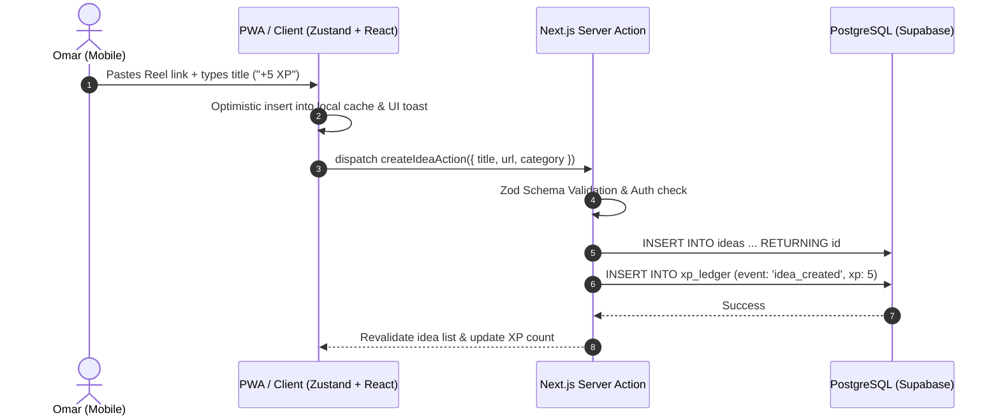
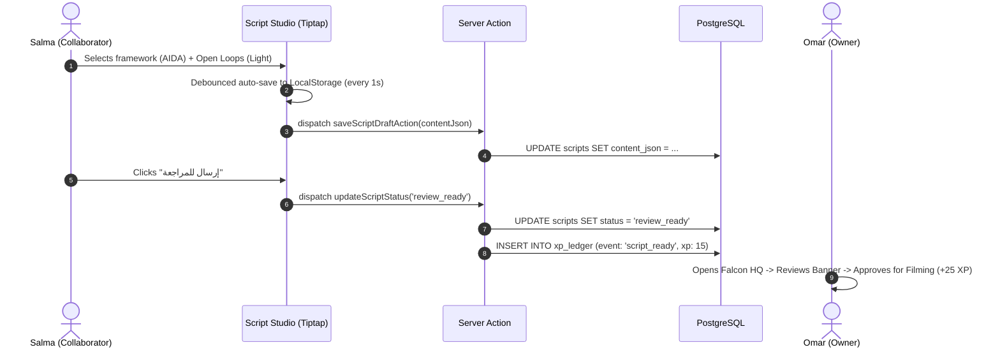

# Stage 7: System Architecture & Design

**Document Path:** `architecture/system-design.md`  
**Date:** 2026-10-21  
**Status:** Approved Baseline  
**Project:** FALCON HQ — Ideas, Scripts & Growth Workspace  

---

## 1. High-Level Architecture Overview

FALCON HQ is architected as an edge-ready, serverless, modular full-stack application built on **Next.js 15 (App Router)** and **PostgreSQL (Supabase)**, optimized for near-instant mobile responsiveness in Egypt with robust offline fallbacks.

```
+-------------------------------------------------------------------------+
|                              CLIENT LAYER                               |
|                                                                         |
|  [ Mobile Viewport / PWA ]                [ Desktop / Tablet Studio ]   |
|  - Offline FAB Quick Capture               - Multi-Column Bento Layout  |
|  - Priority Sliders                        - Full Script Studio Editor  |
|  - Review Notification Queue               - Business Analytics Spark   |
|                                                                         |
|  [ UI Foundation: Tailwind CSS v4 + shadcn/ui + Lucide + Readex Pro ]   |
|  [ State Layer: TanStack Query + Zustand Local Storage Hydration ]      |
+-------------------------------------------------------------------------+
                                    |
                                    | HTTPS / REST / Server Actions
                                    v
+-------------------------------------------------------------------------+
|                         APPLICATION EDGE LAYER                          |
|                                                                         |
|  [ Next.js 15 App Router on Vercel Edge Runtime ]                       |
|  - Server Components (Zero-bundle data rendering)                       |
|  - Server Actions (Mutations, Zod validation, XP ledger triggers)       |
|  - Edge Middleware (Session verification, Route protection)             |
|  - API Routes (Metadata scraper for TikTok/Reels links)                 |
+-------------------------------------------------------------------------+
                                    |
                                    | Supabase SSR Client (Secure JWT)
                                    v
+-------------------------------------------------------------------------+
|                            PERSISTENCE LAYER                            |
|                                                                         |
|  [ Supabase Managed PostgreSQL Database ]                               |
|  - Row-Level Security (RLS) on all tables                               |
|  - Tables: workspaces, ideas, scripts, business_outcomes, xp_ledger     |
|  - Realtime Broadcast (Presence & Soft-locking)                         |
|  - Storage: S3-compatible bucket for compressed case previews           |
+-------------------------------------------------------------------------+
```

---

## 2. Core Architectural Principles

1. **Zero-Latency Mobile Capture (Optimistic Updates):**  
   When Omar taps "حفظ الفكرة" on mobile, the UI updates instantly (`latency = 0ms`). The idea is placed in local Zustand/IndexedDB state and sent to Supabase in the background. If offline, the mutation is queued and synced upon reconnection.
2. **Deterministic Security via PostgreSQL Row-Level Security (RLS):**  
   Security is enforced at the database layer. No API endpoint can query or mutate ideas without an authenticated JWT belonging to the specific Falcon workspace.
3. **Structured Domain Modeling over Free-Form Bloat:**  
   Unlike Notion's generic unstructured block trees, Falcon HQ stores ideas and scripts as strictly typed entities with defined stages, structured copywriting sections (AIDA / PASTOR), and explicit attribution metrics.
4. **Resilient Serverless Footprint ($0 Fixed Operational Cost):**  
   By eschewing long-running stateful Node.js servers, background Redis clusters, and Celery workers, Falcon HQ runs entirely on generous managed serverless tiers (Vercel Edge + Supabase Free/Hobby).

---

## 3. Component Communication Flow

### Flow 1: Idea Ingestion & Multi-Track Routing


### Flow 2: Script Writing & Async Review Handoff


---

## 4. Key Performance & Reliability Targets
- **Mobile First Contentful Paint (FCP):** $< 0.8\text{s}$ on 4G.
- **Time to Interactive (TTI):** $< 1.2\text{s}$.
- **Bundle Size:** $< 120\text{KB}$ initial gzipped JavaScript.
- **RTL Integrity:** Native CSS logical properties (`margin-inline-start`, etc.) guaranteeing zero layout shifts when switching between Arabic and English numbers.
