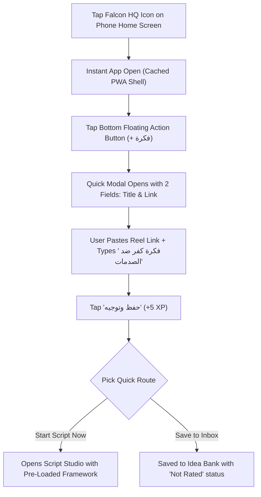
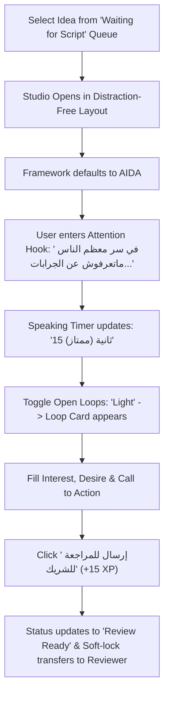

# Stage 8: User Experience Flows & Navigation Architecture

**Document Path:** `design/ux-flows.md`  
**Date:** 2026-10-21  
**Target Viewports:** Mobile-First (PWA 375px–430px) & Desktop Studio (1280px+)  

---

## 1. Information Architecture (Site Map)

```
[ FALCON HQ ROOT ]
  ├── 🏠 الرئيسية (Home Bento Grid)
  │     ├── Hero Inspiration & Quick Capture Bar
  │     ├── Streak & Team Quest Bento
  │     ├── High-Priority Ideas Radar
  │     └── Revenue & Content Sparkline
  │
  ├── 💡 بنك الأفكار (Idea Bank)
  │     ├── Quick Capture Modal / FAB
  │     ├── Filter Bar (Category, Priority, Status)
  │     └── Multi-Track Route Selector
  │
  ├── ✍️ استوديو السكريبتات (Script Studio)
  │     ├── Framework Picker (AIDA, PASTOR, Story Arc, THEDOC)
  │     ├── Open Loops Engine (Off / Light / Full)
  │     ├── Speaking Time Counter
  │     └── Review & Handoff Action Bar
  │
  ├── 💰 نتائج البزنس (Business Results)
  │     ├── Video Outcome Logger
  │     ├── Attributed Revenue & Case Orders
  │     └── Winning Patterns Library
  │
  └── 🏆 لوحة التحفيز (Gamification Ledger)
        ├── XP History & Transparency Log
        ├── Level Progression
        └── Weekly Team Sprints
```

---

## 2. Mobile User Flow: The 15-Second Quick Capture



---

## 3. Desktop User Flow: Script Studio Guided Copywriting


