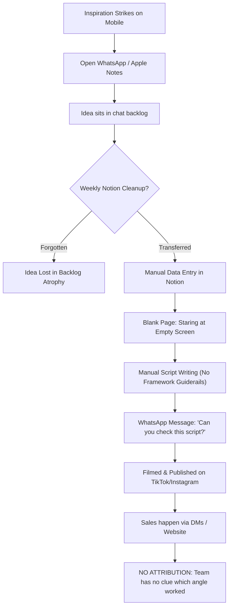
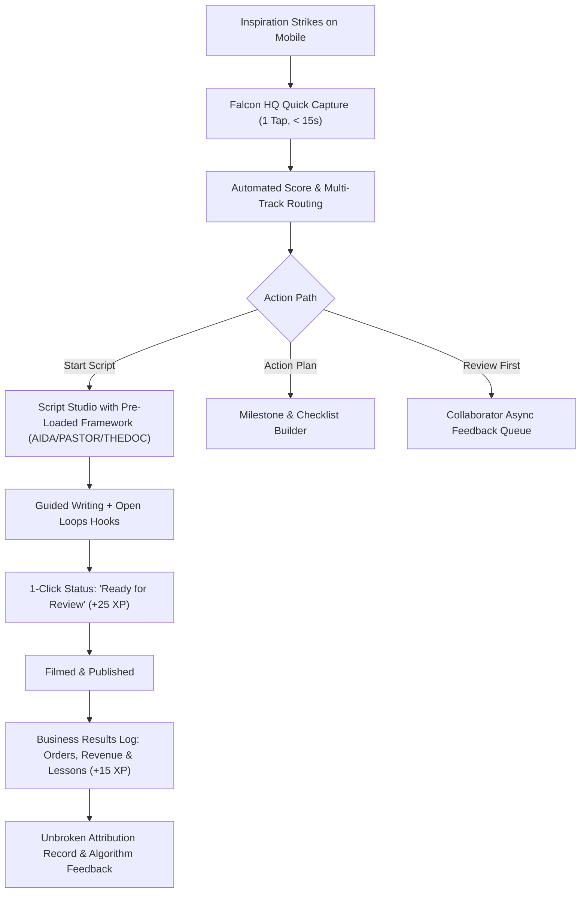

# Stage 1: Problem Discovery & Root Cause Analysis

**Document Path:** `research/problem-discovery.md`  
**Date:** 2026-10-21  
**Project:** FALCON HQ  
**Status:** Validated Analysis  

---

## 1. Executive Problem Summary
The core issue facing Falcon is **not** a lack of creative ideas or a lack of tools like Notion. Rather, it is **Operational Friction and Cognitive Overload**.

Notion is a generic blank canvas. For an agile e-commerce brand operating in the fast-paced Egyptian mobile accessory market, Notion introduces excessive friction:
1. **Friction of Structure:** Creating a new idea in Notion requires opening an app, waiting for cold start, navigating through a nested database tree, picking multi-select tags, and staring at a blank page.
2. **The "Blank Canvas" Writer's Block:** Once an idea is created, turning it into a video script in Notion requires manual structure recall (e.g. "What was the hook again? Where should the call to action go?").
3. **Disconnection Between Content and Cash:** In Notion, video scripts live in one page, marketing notes in another, and actual sales figures in an Excel sheet or WhatsApp chat. There is zero feedback loop revealing which creative angle brought high-margin custom phone case orders.
4. **Motivational Decay:** When creative momentum dips, passive tools like Notion offer zero encouragement, resulting in abandoned drafts and inconsistent posting schedules.

---

## 2. Hypothesis Testing & Validation

| Hypothesis | Assumed Notion Behavior | Actual Reality for Falcon | Validation Outcome |
|---|---|---|---|
| **H1: Number of steps to record an idea is too high.** | User must click through workspace → database → new row → properties. | On mobile, Notion takes 6–10 seconds to load and requires 5+ clicks to set up an idea row. | **Confirmed Critical Bottleneck** |
| **H2: Notion's UI is overly complex for 2 people.** | Notion provides infinite sub-pages, relations, rollups, formulas, and views. | 80% of Notion's UI features are unused and create distraction/visual clutter. | **Confirmed** |
| **H3: Categorization takes longer than the idea itself.** | Users are forced to fill in 8 database properties before writing. | Leads to ideas being left in WhatsApp or phone notes to "sort out later" (which never happens). | **Confirmed** |
| **H4: Scripts are detached from source ideas.** | Script is written in a separate document; context of the original inspiration link is lost. | Writers forget why the idea was exciting or what specific visual angle inspired it. | **Confirmed** |
| **H5: Lack of transparent review and handoff.** | Notification mentions in Notion get drowned in email or app badge fatigue. | The collaborator doesn't know if a script is approved, needs work, or is ready to film. | **Confirmed** |
| **H6: The core problem is execution, not ideation.** | Having 100 ideas does nothing for sales if only 2 get produced. | The bottleneck is moving an idea from *Inbox* to *Structured Script* to *Tested in Reality*. | **Confirmed Core Finding** |
| **H7: Gamification will solve consistency.** | Adding points and streaks automatically motivates people. | Rigid streaks induce stress; only *meaningful, low-friction gamification* tied to real creative output works. | **Partially Confirmed (Requires Balanced Model)** |

---

## 3. Workflow Comparison: Current (Notion / WhatsApp) vs Proposed (Falcon HQ)

### The As-Is Workflow (Friction-Riddled):

### The To-Be Workflow in Falcon HQ:

---

## 4. Key Discovery Findings for Product Engineering
1. **Mobile Experience dictates product survival:** If mobile entry takes more than two taps, the founder will revert to WhatsApp.
2. **Frameworks must be opinionated but non-intrusive:** The Script Studio must provide structure without acting like an inflexible form.
3. **The feedback loop must be closed:** The Business Results module must celebrate revenue and learning, feeding directly back into future idea prioritization.
